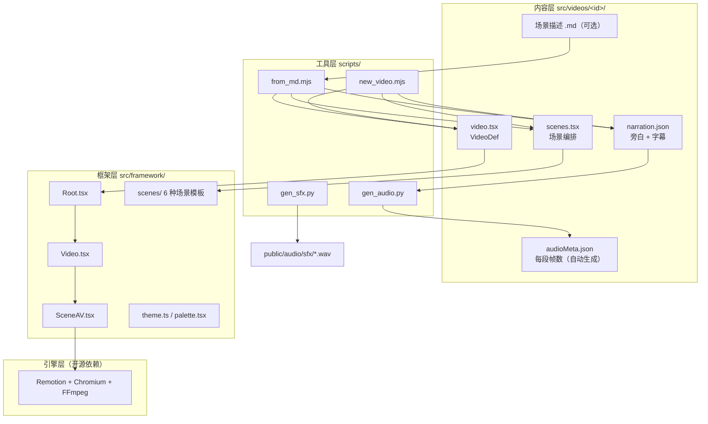
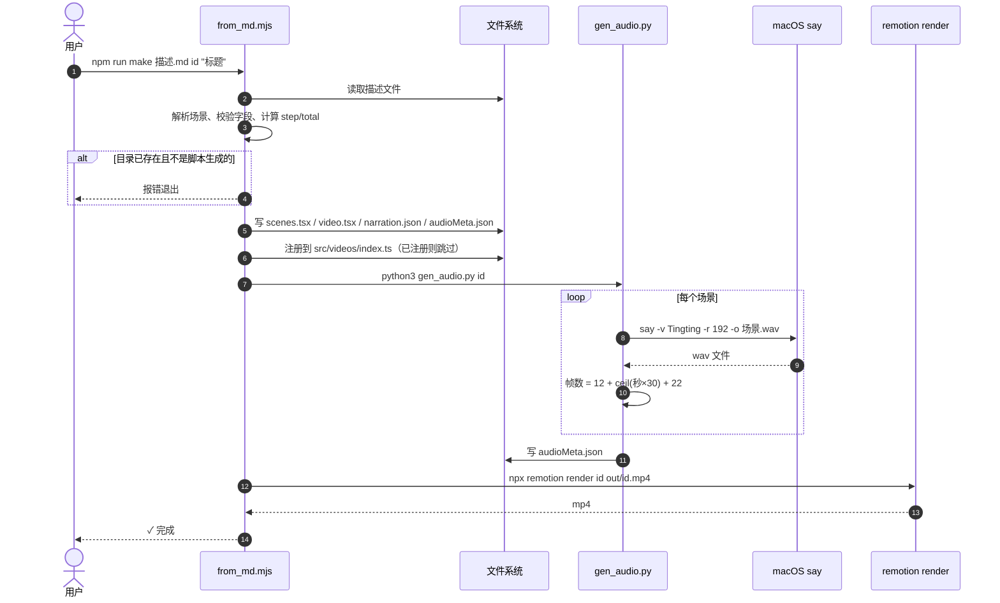
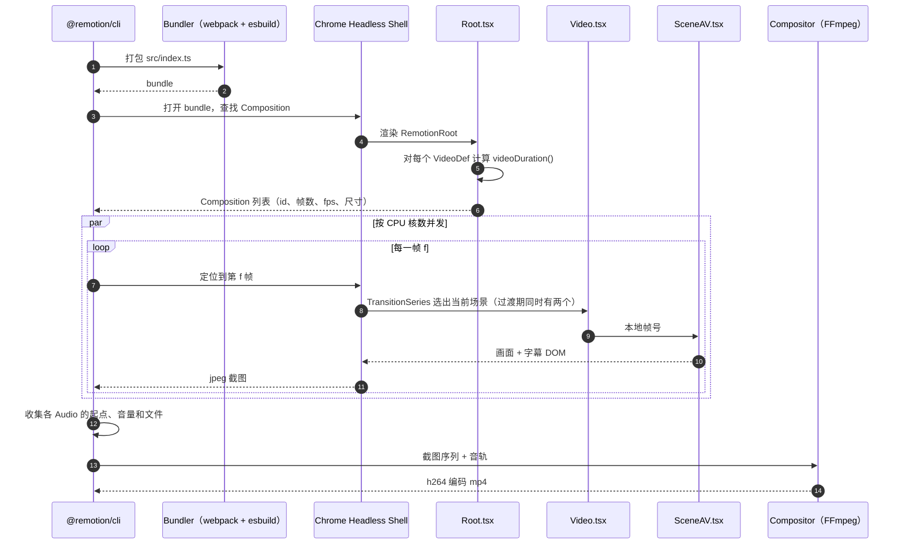
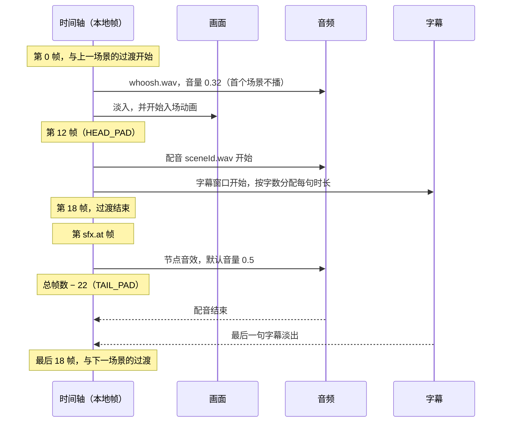

# video-studio 技术文档

> 版本：基于 `main` 分支，依赖以 2026-11-03 的 `node_modules` 实际安装版本为准。

## 1. 概述

video-studio 用 React 代码描述视频画面，由 Remotion 逐帧渲染成 mp4。一个仓库维护多支分享视频，每支视频自带中文配音、音效和字幕。

设计上有三个要点：

- **框架与内容分离**：`src/framework/` 是所有视频共用的引擎，`src/videos/<id>/` 只放一支视频的内容。
- **一支视频 = 一个 `VideoDef`**：声明 id、标题、场景、配音和配色，框架据此注册视频。
- **配音决定时长**：每个场景的帧数由配音长度算出，不手写。

## 2. 分层架构



## 3. 目录与职责

- `src/index.ts`：调用 `registerRoot(RemotionRoot)`，是 Remotion 的入口。
- `src/Root.tsx`：遍历 `VIDEOS`，为每个 `VideoDef` 注册一个 `Composition`。
- `src/videos/index.ts`：视频注册表 `VIDEOS`。
- `src/framework/types.ts`：`VideoDef`、`SceneEntry` 等类型，以及 `TRANSITION_FRAMES = 18` 和总帧数计算 `videoDuration()`。
- `src/framework/Video.tsx`：用 `TransitionSeries` 串联场景，场景之间是 18 帧淡入淡出。
- `src/framework/components/SceneAV.tsx`：给单个场景叠加配音、过场音、节点音效和字幕。
- `src/framework/components/Captions.tsx`：按字数加权，把字幕铺到时间轴上。
- `src/framework/scenes/`：Title / List / Code / Pipeline / Exchange / Recap 六种场景模板，以及骨架 `_Blank.tsx`。
- `src/framework/theme.ts`、`palette.tsx`：结构色和字体，以及 `makePalette` 主题配色和 `usePalette` 取色。
- `scripts/gen_audio.py`：用 `say` 生成配音并回写 `audioMeta.json`。
- `scripts/gen_sfx.py`：用纯 Python 合成 `whoosh`、`ding`、`ding-bright`、`type` 四个音效。
- `scripts/new_video.mjs`：以 template 为起点新建视频目录。
- `scripts/from_md.mjs`：从场景描述文件一键生成视频。
- `remotion.config.ts`：帧图片格式 jpeg、自动并发、覆盖已有输出。
## 4. 核心数据结构

```ts
type SceneEntry = { id: string; node: React.ReactNode; sfx?: { file: string; at: number; volume?: number }[] };
type NarrationItem = { text: string; captions: string[] };
type AudioMeta = Record<string, { durationInFrames: number; seconds: number }>;

type VideoDef = {
  id: string;            // Composition id，也是音频目录 public/audio/<id>/
  title: string;
  fps?: number;          // 默认 30
  width?: number;        // 默认 1920
  height?: number;       // 默认 1080
  palette?: Palette;
  scenes: SceneEntry[];
  narration: Record<string, NarrationItem>;
  audioMeta: AudioMeta;
};
```

三者靠**场景 id** 关联：`scenes[i].id` 等于 `narration` 的 key，也等于 `audioMeta` 的 key，还是配音文件名 `<id>.wav`。

## 5. 时序图

### 5.1 从描述文件到成片（`npm run make`）



手写视频不经过 `from_md.mjs`：用 `npm run new` 建目录，手动注册并编辑内容，再用 `npm run audio <id>` 和 `npx remotion render` 完成后两步。

### 5.2 渲染内部（`remotion render`）



### 5.3 单个场景内部的时间轴

以场景本地帧为准，过渡 18 帧：


## 6. 时长与同步计算

单个场景：

$$\text{durationInFrames} = \text{HEAD\_PAD}(12) + \lceil \text{配音秒数} \times 30 \rceil + \text{TAIL\_PAD}(22)$$

全片（相邻场景重叠一个过渡）：

$$\text{总帧数} = \sum_i \text{durationInFrames}_i - (\text{场景数} - 1) \times 18$$

字幕窗口从第 12 帧开始，长度为 `durationInFrames − 34`，正好等于配音长度。第 i 句字幕的时长为 `窗口长度 × 第 i 句字数 / 总字数`，进出各有 8 帧淡变。

## 7. 已知约束与风险

- **留白常量重复**：`HEAD_PAD` / `TAIL_PAD` 在 `gen_audio.py` 和 `SceneAV.tsx` 各写一份，改动时要两处同步。
- **配音在过渡中开口**：配音从第 12 帧开始，过渡在第 18 帧才结束，所以淡入到大约 2/3 时就会出声。`TAIL_PAD` 22 帧大于 18 帧，相邻两段配音不会重叠。
- **FPS 写死为 30**：`gen_audio.py` 固定按 30fps 计算。给视频设置其他 `fps`，时长会算错。
- **字幕按字符数分配**：依据是 `string.length`，中英文混排或含 emoji 时，字幕和语音会有偏差。
- **配音文件没有兜底**：缺少 `audioMeta` 时按 150 帧兜底，但缺少 wav 时导出会失败。
- **配音只能在 macOS 上生成**：依赖系统的 `say` 命令和 Tingting 语音。
- **校验手段少**：没有 lint 和测试，只能用 `npx tsc --noEmit`、Studio 预览或真实导出来检查。

## 8. 使用的开源项目

### 8.1 直接依赖（`package.json`）

- **Remotion** `remotion` 4.0.540：用 React 描述视频的核心库，提供 `Composition`、`Sequence`、`Audio`、`useCurrentFrame`、`spring`、`interpolate`。
- **@remotion/cli** 4.0.540：`remotion studio` 和 `remotion render` 命令行工具。
- **@remotion/transitions** 4.0.540：`TransitionSeries` 和 `fade()` 过渡。
- **React** `react` / `react-dom` 19.3.1，MIT：画面组件。
- **TypeScript** 5.9.3，Apache-2.0：类型检查（开发依赖）。
- **@types/react**、**@types/react-dom** 19.3.0，MIT：React 类型定义（开发依赖）。

### 8.2 间接依赖（Remotion 带入，渲染链路必需）

- **@remotion/bundler**：用 **webpack** 5.112.2（MIT）和 **esbuild** 0.28.1（MIT）打包项目代码。
- **@remotion/renderer**：驱动无头浏览器逐帧截图，再调用编码器。
- **Chrome Headless Shell**（Chromium，BSD-3-Clause）：在 `npm install` 时下载到 `node_modules/.remotion/`，负责渲染每一帧画面。
- **FFmpeg**（LGPL/GPL）：随 `@remotion/compositor-darwin-arm64` 一起分发，包括 `ffmpeg`、`ffprobe` 和 `libav*` 动态库，负责编码 h264 和混合音轨。
- **@remotion/studio**：`npm run dev` 打开的预览界面。

`node_modules` 里还有 `@remotion/captions`、`@remotion/openai-whisper`、`@remotion/elevenlabs` 等包，它们是 `@remotion/studio` 的依赖，随 `@remotion/cli` 一起装进来，项目代码没有使用。

### 8.3 系统与运行时

- **Node.js** 18+：运行 Remotion 和 Node 脚本。
- **Python 3** 标准库：`gen_audio.py` 用到 `wave`、`subprocess`、`json`、`math`、`glob`；`gen_sfx.py` 用到 `wave`、`struct`、`math`、`random`。没有第三方 Python 包。
- **macOS `say`** 和 Tingting 中文语音：系统自带，不是开源软件。
- **字体**：`theme.ts` 指定 PingFang SC / Microsoft YaHei / Hiragino Sans GB，都由系统提供，项目不打包字体。

### 8.4 许可证注意

- **Remotion 不是 OSI 意义上的开源软件**。它是"源码公开 + 双层授权"：个人和小公司免费，达到一定规模的营利组织需要购买 Company License（见 `node_modules/remotion/LICENSE.md`）。`@remotion/transitions` 的 package.json 里写的是 `UNLICENSED`，同样受 Remotion License 约束。
- **FFmpeg** 以 LGPL/GPL 授权，随 Remotion 的 compositor 一起分发。对外分发包含它的产物时，要遵守相应条款。
- 用于商业项目前，请先确认 Remotion 的授权。

## 9. 参考资料

> 以下链接在 2026-11-03 均已检查可访问。

### 9.1 Remotion

- GitHub：<https://github.com/remotion-dev/remotion>
- 文档首页：<https://www.remotion.dev/docs>
- 许可证：<https://github.com/remotion-dev/remotion/blob/main/LICENSE.md>，价格与免费资格 <https://www.remotion.dev/docs/license/pricing>
- 项目里用到的 API：
  - 入口与注册：[`registerRoot`](https://www.remotion.dev/docs/register-root)、[`<Composition>`](https://www.remotion.dev/docs/composition)、[`<Folder>`](https://www.remotion.dev/docs/folder)
  - 时间线：[`<Sequence>`](https://www.remotion.dev/docs/sequence)、[`useCurrentFrame`](https://www.remotion.dev/docs/use-current-frame)
  - 动画：[`spring`](https://www.remotion.dev/docs/spring)、[`interpolate`](https://www.remotion.dev/docs/interpolate)
  - 音频与静态资源：[`<Audio>`](https://www.remotion.dev/docs/audio)（新版名为 [`<Html5Audio>`](https://www.remotion.dev/docs/html5-audio)）、[`staticFile`](https://www.remotion.dev/docs/staticfile)
- 过渡（`@remotion/transitions`）：
  - [`<TransitionSeries>`](https://www.remotion.dev/docs/transitions/transitionseries)：文档写明过渡会让相邻场景重叠，总时长减去过渡帧数，与本项目 `videoDuration()` 的算法一致
  - [`fade()`](https://www.remotion.dev/docs/transitions/presentations/fade)、[`linearTiming()`](https://www.remotion.dev/docs/transitions/timings/lineartiming)
- 命令行与配置：[`remotion render`](https://www.remotion.dev/docs/cli/render)、[`remotion studio`](https://www.remotion.dev/docs/cli/studio)、[`remotion.config.ts`](https://www.remotion.dev/docs/config)
- 底层包：[`@remotion/bundler`](https://www.remotion.dev/docs/bundler)、[`@remotion/renderer`](https://www.remotion.dev/docs/renderer)
- 浏览器：[Chrome Headless Shell 说明](https://www.remotion.dev/docs/miscellaneous/chrome-headless-shell)，解释 Remotion 为什么下载、固定这个浏览器版本，以及它在 `node_modules/.remotion/` 下的位置

### 9.2 前端与构建

- React：GitHub <https://github.com/react/react>（原 `facebook/react`，已迁移），文档 <https://react.dev>
- TypeScript：GitHub <https://github.com/microsoft/TypeScript>，文档 <https://www.typescriptlang.org/docs/>
- `@types/react`、`@types/react-dom`：来自 DefinitelyTyped <https://github.com/DefinitelyTyped/DefinitelyTyped>
- webpack：GitHub <https://github.com/webpack/webpack>，文档 <https://webpack.js.org>
- esbuild：GitHub <https://github.com/evanw/esbuild>，文档 <https://esbuild.github.io>

### 9.3 渲染与编码

- Chromium：源码 <https://chromium.googlesource.com/chromium/src>；Chrome 官方关于 Headless Shell 的说明 <https://developer.chrome.com/blog/chrome-headless-shell>
- FFmpeg：官网 <https://ffmpeg.org>，GitHub 镜像 <https://github.com/FFmpeg/FFmpeg>，许可证说明 <https://ffmpeg.org/legal.html>

### 9.4 运行时与系统工具

- Node.js：GitHub <https://github.com/nodejs/node>，API 文档 <https://nodejs.org/docs/latest/api/>
- Python：GitHub <https://github.com/python/cpython>；脚本用到的 [`wave`](https://docs.python.org/3/library/wave.html) 模块用来读写 wav 文件
- macOS `say`：不开源，没有 GitHub 仓库。本机可运行 `man say` 查看手册，第三方整理的参数说明见 <https://ss64.com/mac/say.html>

### 9.5 文档工具

- Mermaid（本文档中的时序图）：GitHub <https://github.com/mermaid-js/mermaid>，时序图语法 <https://mermaid.js.org/syntax/sequenceDiagram.html>
